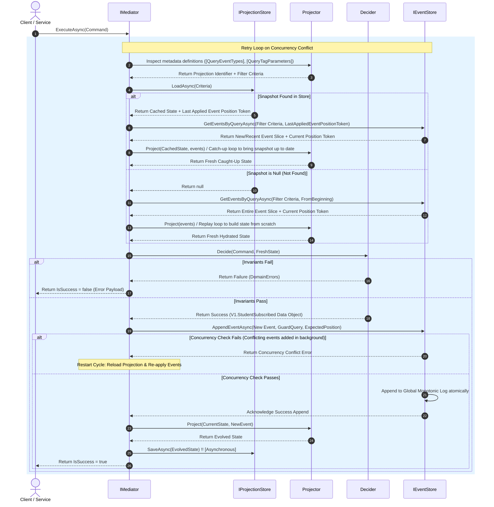
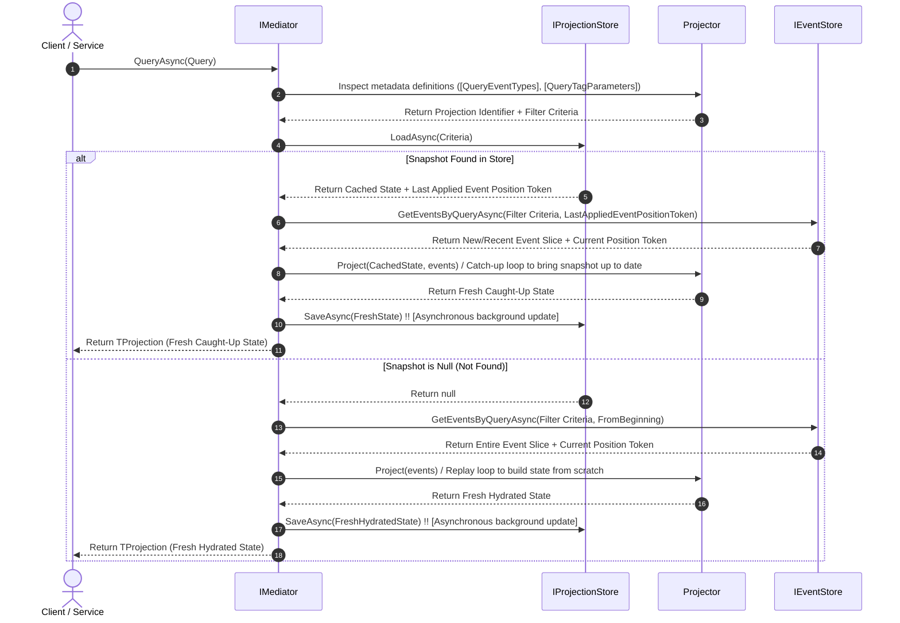

#  Filin

**Filin** is an Event Sourcing framework featuring **Dynamic Consistency Boundary (DCB)** support.
It includes a native implementation of an **append-only event store** powered by **PostgreSQL**
with strict global message ordering, which enables the system to reliably evaluate
these dynamic consistency boundaries on write operations.

[](https://github.com/ppetukhov/filin/releases/latest)
[](LICENSE)

## 🧩 Key Components

- **Mediator**: Coordinates execution across the framework, exposing a unified interface to process
both operational write **Commands** and read-optimized **Queries**.
- **Event Store**: PostgreSQL-backed event engine ensuring absolute global transaction ordering,
dynamic query-tag evaluation, and built-in **event streaming** capabilities.
- **Projection Store**: Out-of-the-box PostgreSQL implementation for caching and persisting projection snapshots
to minimize replaying logs from scratch.

## 🏷️ Dynamic Consistency Boundaries (DCB)

**DCB** is an architectural pattern designed for
event-driven systems to enforce strong consistency dynamically.
Instead of locking rigid predefined data aggregates or relying on complex Sagas,
DCB calculates a context-sensitive consistency boundary on the fly using targeted
event queries.

### 🌟 Key Features

- **Event Tagging**: Every event is published with a specific type and a set of tags.
This allows a single event to affect multiple entities or business concepts simultaneously.
- **Global Order**: A single logical writer handles each bounded context, assigning
a strict, monotonic position to every single event. The event log maintains one global sequence;
secondary structures like type columns and tag indexes are fully rebuildable by replaying this log.
- **Query-Based Reading**: To make a business decision, the client issues a query filtered by
event types and tags to fetch only the exact historical events relevant to that decision.
- **Query-Guarded Writing**: When writing back a decision event, the system uses optimistic
locking based on the same query used during the read phase. The store validates that
no conflicting events matching that specific query criteria have been appended since the data was read.

## 📦 NuGet Packages

| Package | Description |
|---------|-------------|
| [Filin.Abstractions](https://www.nuget.org/packages/Filin.Abstractions) | Contains core Filin primitives, annotation attributes, and interfaces. |
| [Filin](https://www.nuget.org/packages/Filin) | Core implementation of the Filin `IMediator`. |
| [Filin.EventStore.AdoNet](https://www.nuget.org/packages/Filin.EventStore.AdoNet) | ADO.NET-based implementation of the Filin `IEventStore`. |
| [Filin.ProjectionStore.AdoNet](https://www.nuget.org/packages/Filin.ProjectionStore.AdoNet) | ADO.NET-based implementation of the Filin `IProjectionStore`. |

## 🚀 Quick Start

### 1. Install the NuGet Package

Run the following commands in your terminal to install the core package along with the AdoNet providers for EventStore and ProjectionStore:

```
dotnet add package Filin
dotnet add package Filin.EventStore.AdoNet
dotnet add package Filin.ProjectionStore.AdoNet
dotnet add package Npgsql
```

### 2. Configure PostgreSQL

Execute the initialization scripts provided below in your PostgreSQL database to set up the required schema for both the EventStore and ProjectionStore:

```
PostgreSQL-EventStore.sql
PostgreSQL-ProjectionStore.sql
```

### 3. Configure Filin

Register **Filin** services in your dependency injection container and configure the database connections. 

Add the configuration logic to your `Program.cs`:

```csharp
using Filin.DependencyInjection;

var builder = WebApplication.CreateBuilder(args);

builder.Services
    .AddFilin()
    .AddEventStoreAdoNet()
    .AddProjectionStoreAdoNet()
    // Auto-discover events, commands, queries, projectors and projections
    .AddTypeManifestAssembly(typeof(DomainEvents.V1.CourseCreated).Assembly, typeof(SubscribeStudentToCourse).Assembly);

var app = builder.Build();
app.Run();
```

Then, set up your PostgreSQL connection strings and service settings in `appsettings.json`:

```json
{
  "ConnectionStrings": {
    "LocalPostgresDev": "Server=localhost;Port=5432;Database=dev;Search Path=public;Application Name=Awesome App;User Id=***;Password=***"
  },
  "Filin": {
    "EventStore": {
      "ConnectionName": "LocalPostgresDev",
      "Invariant": "Npgsql"
    },
    "ProjectionStore": {
      "ConnectionName": "LocalPostgresDev",
      "Invariant": "Npgsql"
    }
  }
}
```

## 🏗️ Implementing the Pattern: Commands, State, Projectors, and Deciders

To process a business action inside a dynamic consistency boundary, you define four tightly coupled components:
a **Command** declaring intent, a targeted **State** projection, a **Projector** that abstracts log queries
and state hydration, and a pure **Decider** containing invariant validation.

### 1. Defining Events

Every event in the system is explicitly categorized by an event type name and a set of tags mapped to its properties.
This allows a single event to cleanly affect multiple independent domain concepts or entities simultaneously.

For instance, while a `CourseCreated` or `StudentRegistered` event relates to a single entity,
a `StudentSubscribed` event naturally carries both tags, cross-cutting both domains in the global log:

```csharp
using Filin;

static partial class DomainEvents
{
    internal static partial class V1
    {
        [EventType("CourseCreated")]
        public sealed record CourseCreated([EventTag("course")] Guid CourseId, string Name);

        [EventType("StudentRegistered")]
        public sealed record StudentRegistered([EventTag("student")] public Guid StudentId, string Name);

        [EventType("StudentSubscribed")]
        public sealed record StudentSubscribed([EventTag("course")] Guid CourseId, [EventTag("student")] Guid StudentId);
    }
}
```

### 2. Defining the Command

A command explicitly states a business intent and wraps the tags required to query the event log. It implements ICommand<TState>,
mapping it directly to the exact state projection it needs for context evaluation.

```csharp
using Filin;

/// <summary>
/// Represents a command to subscribe a student to a specific course.
/// </summary>
/// <param name="CourseId">The unique identifier of the target course.</param>
/// <param name="StudentId">The unique identifier of the student.</param>
public sealed partial record SubscribeStudentToCourse([EventTag("course")] Guid CourseId, [EventTag("student")] Guid StudentId) : ICommand<StudentCourseSubscriptionState>;
```

### 3. The State Projection

Unlike an enterprise-wide read model or a fat DDD aggregate, this state object is a lightweight projection designed exclusively to validate this decision process.
It filters down historical events to hold only the consolidated data point context required by the business rule.

```csharp
using Filin;

/// <summary>
/// Holds the consolidated read-state required to validate a student's subscription to a specific course.
/// </summary>
public sealed record StudentCourseSubscriptionState
{
    /// <summary>
    /// Gets the unique identifier of the student.
    /// </summary>
    [JsonPropertyName("student_id")]
    public required Guid StudentId { get; init; }

    /// <summary>
    /// Gets the unique identifier of the target course.
    /// </summary>
    [JsonPropertyName("course_id")]
    public required Guid CourseId { get; init; }

    /// <summary>
    /// Gets the set of course IDs the student is currently subscribed to.
    /// </summary>
    [JsonPropertyName("subscribed_course_ids")]
    public ImmutableHashSet<Guid> SubscribedCourseIds { get; init; } = [];
}
```

### 4. Designing the Projector

The Projector serves a dual purpose. First, its declarative metadata attributes (`[QueryEventTypes]`, `[QueryTagParameters]`)
define exactly which events and tags the DCB framework needs to pull from the global event store log.
Second, it implements the functional mapping to reduce that sequence of events down into your target State projection.

```csharp
using Filin;
using V1 = DomainEvents.V1;

[ProjectorId("SubscribeStudentToCourseProjector")]
[QueryEventTypes(1, "CourseCreated")]
[QueryEventTypes(2, "StudentRegistered", "StudentSubscribed")]
[QueryTagParameters(1, "course")]
[QueryTagParameters(2, "student")]
sealed partial class SubscribeStudentToCourseProjector : IProjector<StudentCourseSubscriptionState>
{
    // Evaluated when building state from the first relevant event found in the log
    public static StudentCourseSubscriptionState Project(DcbEventSequenced domainEvent) =>
        domainEvent.Event.Payload switch
        {
            V1.CourseCreated evt => Create(evt),
            V1.StudentRegistered evt => Create(evt),
            var evt => throw UnexpectedEventTypeException(evt)
        };

    // Evaluated for all subsequent relevant events to continually hydrate the projection
    public static StudentCourseSubscriptionState Project(StudentCourseSubscriptionState state, DcbEventSequenced domainEvent) =>
        domainEvent.Event.Payload switch
        {
            V1.CourseCreated evt => Update(state, evt),
            V1.StudentRegistered evt => Update(state, evt),
            V1.StudentSubscribed evt => Update(state, evt),
            var evt => throw UnexpectedEventTypeException(evt)
        };

    static StudentCourseSubscriptionState Create(V1.CourseCreated evt) => new() { StudentId = default, CourseId = evt.CourseId };

    static StudentCourseSubscriptionState Create(V1.StudentRegistered evt) => new() { StudentId = evt.StudentId, CourseId = default };

    static StudentCourseSubscriptionState Update(StudentCourseSubscriptionState state, V1.CourseCreated evt) => state with { CourseId = evt.CourseId };

    static StudentCourseSubscriptionState Update(StudentCourseSubscriptionState state, V1.StudentRegistered evt) => state with { StudentId = evt.StudentId };

    static StudentCourseSubscriptionState Update(StudentCourseSubscriptionState state, V1.StudentSubscribed evt) => state with
    {
        SubscribedCourseIds = state.SubscribedCourseIds.Add(evt.CourseId)
    };

    static UnexpectedEventTypeException UnexpectedEventTypeException(object? evt) => new UnexpectedEventTypeException(evt?.GetType());
}
```

### 5. Designing the Decider

The decider is a pure execution component marked with the `[Decider]` attribute.
It handles the business logic and outputs the tracking events if successful, wrapping them using `.ToDcbEvent()`.

```csharp
using Filin;

[Decider]
sealed class SubscribeStudentToCourseDecider : IDecider<SubscribeStudentToCourse, StudentCourseSubscriptionState>
{
    // Fallback: Invoked when the system finds zero historical events for the requested context tags
    public static DecideResult Decide(SubscribeStudentToCourse command) => DomainErrors.Course.NotFound(command.CourseId);

    // Primary Execution: Invoked once the DCB store has projected the log history into the local state
    public static DecideResult Decide(SubscribeStudentToCourse command, StudentCourseSubscriptionState state)
    {
        if (state.StudentId == default)
        {
            return DomainErrors.Student.NotFound(command.StudentId);
        }

        if (state.CourseId == default)
        {
            return DomainErrors.Course.NotFound(command.CourseId);
        }

        if (state.SubscribedCourseIds.Contains(command.CourseId))
        {
            return DomainErrors.Student.AlreadySubscribed(command.StudentId, command.CourseId);
        }

        // Return the successfully produced domain event, inheriting tags directly from the command context
        return new V1.StudentSubscribed(CourseId: command.CourseId, StudentId: command.StudentId)
                        .ToDcbEvent(command.GetTags());
    }
}

/// <summary>
/// Centralized factory for all domain and business errors.
/// </summary>
static class DomainErrors
{
    internal static class Student
    {
        internal static DecideResult NotFound(Guid studentId) => ("STUDENT_NOT_FOUND", $"Student with ID '{studentId}' was not found.");

        internal static DecideResult AlreadySubscribed(Guid studentId, Guid courseId) => ("STUDENT_ALREADY_SUBSCRIBED", $"Student with ID '{studentId}' is already subscribed to course with ID '{courseId}'.");
    }

    internal static class Course
    {
        internal static DecideResult NotFound(Guid courseId) => ("COURSE_NOT_FOUND", $"Course with ID '{courseId}' was not found.");
    }
}
```

## ⚡ Execution via Mediator

The framework seamlessly hides the orchestration of fetching events, running your `Projector`, invoking the `Decider`,
and executing query-guarded updates behind a simple `IMediator` abstraction.
Application services can instantiate commands and dispatch them natively.
The mediator automatically pairs the command to its respective projection engine and handles pipeline exceptions when invariants break down:

```csharp
// Endpoint for creating a student course subscription
app.MapPost("/api/courses/{courseId:guid}/subscribes", async (
    Guid courseId, 
    [FromBody] SubscribeRequest request, 
    IMediator mediator, 
    ILogger<Program> logger, 
    CancellationToken cancellationToken) =>
{
    var command = new SubscribeStudentToCourse(courseId, request.StudentId);

    var res = await mediator.ExecuteAsync<SubscribeStudentToCourse, StudentCourseSubscriptionState>(command, cancellationToken);

    if (res.IsSuccess)
    {
        logger.LogInformation("Student {StudentId} successfully subscribed to course {CourseId}", request.StudentId, courseId);
        
        var locationUri = $"/api/courses/{courseId}/subscribes/{request.StudentId}";
        return Results.Created(locationUri, res.State); 
    }
    else
    {
        logger.LogWarning("Business rule violation when subscribing student {StudentId} to course {CourseId}: {ErrorCode} {ErrorMessage}", request.StudentId, courseId, res.Error.Code, res.Error.Message);
        
        // Returns an RFC 7807 compliant 422 Problem Details response
        return Results.Problem(
            detail: res.Error.Message, // The actual domain message (e.g., "Course is full")
            statusCode: StatusCodes.Status422UnprocessableEntity,
            title: "Business Rule Violation",
            type: $"https://example.com/errors/{res.Error.Code}" // Optional URI reference to error type
        );
    }
})
.WithName("SubscribeStudent");

public record SubscribeRequest(Guid StudentId);
```

## 🔍 Querying Projections

To fetch read-only application projections without executing commands or evaluating business decision blocks, the mediator provides a matching `QueryAsync` engine pipeline.
Just like command execution, the pipeline internally utilizes the same caching and catch-up mechanism—calling `IProjectionStore` first,
loading any missing events from the event log via the metadata declarations on the query's projector, updating the state, and caching it asynchronously.

### 1. Define the Query and Target View State

```csharp
using Filin;

/// <summary>
/// Represents a query request to retrieve all active courses.
/// </summary>
public sealed record GetActiveCourses : IQuery<ActiveCourses>
{
    /// <inheritdoc/>
    public Tags GetTags() => [];
}

/// <summary>
/// Represents the domain read-state containing all active courses.
/// </summary>
public sealed record ActiveCourses
{
    /// <summary>
    /// Gets the collection of active courses mapped by their unique identifiers and names.
    /// </summary>
    [JsonPropertyName("courses")]
    public required ImmutableDictionary<Guid, string> Courses { get; init; }
}
```

### 2. Define the Dedicated Query Projector

```csharp
using Filin;

[ProjectorId("ActiveCoursesProjector")]
[QueryEventTypes("CourseCreated")]
sealed partial class ActiveCoursesProjector : IProjector<ActiveCourses>
{
    /// <inheritdoc/>
    public static ActiveCourses Project(DcbEventSequenced domainEvent) =>
        domainEvent.Event.Payload switch
        {
            V1.CourseCreated evt => Add(evt.CourseId, evt.Name),
            var evt => throw UnexpectedEventTypeException(evt)
        };

    /// <inheritdoc/>
    public static ActiveCourses Project(ActiveCourses state, DcbEventSequenced domainEvent) =>
        domainEvent.Event.Payload switch
        {
            V1.CourseCreated evt => Upsert(state, evt.CourseId, evt.Name),
            var evt => throw UnexpectedEventTypeException(evt)
        };

    static ActiveCourses Add(Guid courseId, string name) => new() { Courses = ImmutableDictionary<Guid, string>.Empty.Add(courseId, name) };

    static ActiveCourses Upsert(ActiveCourses state, Guid courseId, string courseName) => state with { Courses = state.Courses.SetItem(courseId, courseName) };

    static UnexpectedEventTypeException UnexpectedEventTypeException(object? evt) =>
        new UnexpectedEventTypeException(evt?.GetType());
}

```

### 3. Dispatch the Query via Mediator

```csharp
app.MapGet("/api/courses", async (IMediator mediator, CancellationToken cancellationToken) =>
{
    var query = new GetActiveCourses();

    // Fetches cache state, catches up from log via ActiveCoursesProjector, saves cache, and returns view
    var result = await mediator.QueryAsync<GetActiveCourses, ActiveCourses>(query, cancellationToken);

    return Results.Ok(result ?? new ActiveCourses { Courses = System.Collections.Immutable.ImmutableDictionary<Guid, string>.Empty });

})
.WithName("GetActiveCourses")
```

## 🛠️ How Filin Works

The transactional lifecycle of a single execution flow inside a dynamic consistency boundary
behaves like an elastic aggregate sandbox. The transaction follows three core sequence phases:

###  1️⃣ FETCH & REPLAY (Read)

Framework attempts to load a ready snapshot from `IProjectionStore`.
It then queries the log using the projector's metadata parameters (`[QueryEventTypes]`, `[QueryTagParameters]`)
to pull only a targeted slice of dense events—either fetching new records since the snapshot's last applied position,
or replaying from the beginning if no snapshot exists.

###  2️⃣ EVALUATE (Decide)

The framework invokes the `IDecider` block. If a state was successfully hydrated from the log,
**both the command data and the state** are evaluated together;
**if no state exists, only the command data is passed and processed**.
In-memory business rules evaluate this input against domain invariants to either yield **Domain Rule Errors** (structured error collections)
or generate **one or more valid new domain events** (tracking facts).

###  3️⃣ GUARDED APPEND & PROJECTION UPDATE (Write)

- **Event Store**: Receives the new event data array along with the exact same query criteria and
the last verified global transaction offset position token. The single logical writer validates that
no concurrent operations matching those query tags have hit the log since your read operation.
If the check passes, the transaction is atomically appended to the global sequence order, and a success confirmation is returned.
- **Framework**: Upon receiving a success confirmation from the event store, the `Mediator` immediately updates the current projection snapshot
*in-memory* with the new event and issues a background asynchronous call via `IProjectionStore` to persist the newly updated state.

### ⚙️ Command Pipeline Sequence Diagram



### ⚙️ Query Pipeline Sequence Diagram



## ⚡ Performance

Below is a benchmark showing the execution time for concurrent, non-conflicting operations:

* **Simultaneous Commands:** 5,000 commands (non-conflicting)
* **Total Duration:** 17,972 ms (~18.0 seconds)
* **Average Duration:** 3.594 ms per command
* **Average Throughput:** 278 commands per second

*Note: These benchmarks were recorded with both the `EventStore` and `ProjectionStore` hosted on the same Relational Database Management System (RDBMS).*

Benchmarked on Windows 11, .NET 10.0.14, PostgreSQL 18.6 on Docker Desktop 4.90.0, CPU Intel Core i7 @ 2.80GHz, 32GB RAM, NVMe SSD storage

## ⚠️ Critical Architectural Trade-offs

Before adopting DCB, ensure your infrastructure requirements align with its core design:
- **Single Logical Writer**: Designed to run as a single-node server (or active-passive cluster) acting as one logical writer per bounded context.
- **No Horizontal Write Sharding**: If your system requires scaling write throughput horizontally
by sharding event streams across multiple machines, **this is the wrong tool**.
DCB prioritizes a single, dense, monotonic global order to guarantee dynamic consistency.

## 📚 Documentation

- [DCB Specification](https://dcb.events/specification/) - Dynamic Consistency Boundaries pattern

## 📄 License

This project is licensed under the MIT License - see the [LICENSE](LICENSE) file for details.